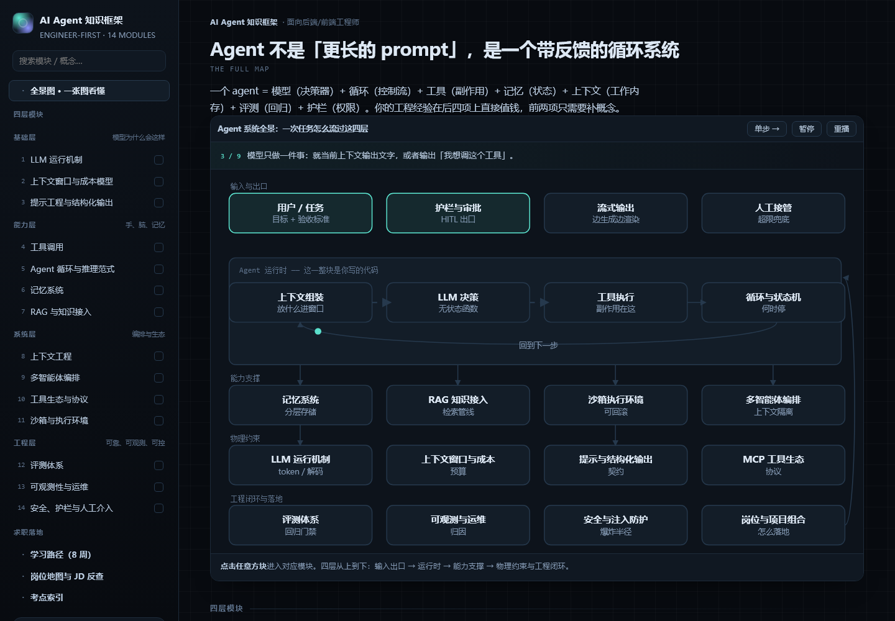
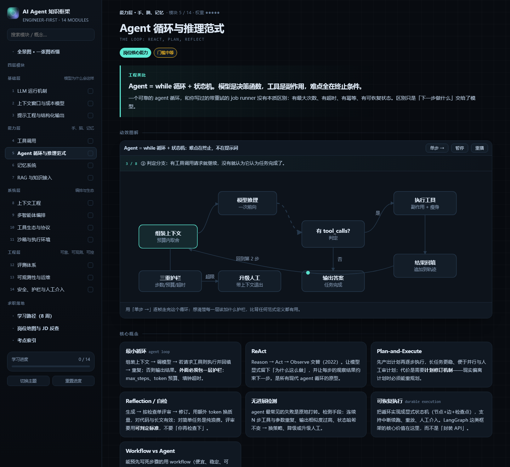
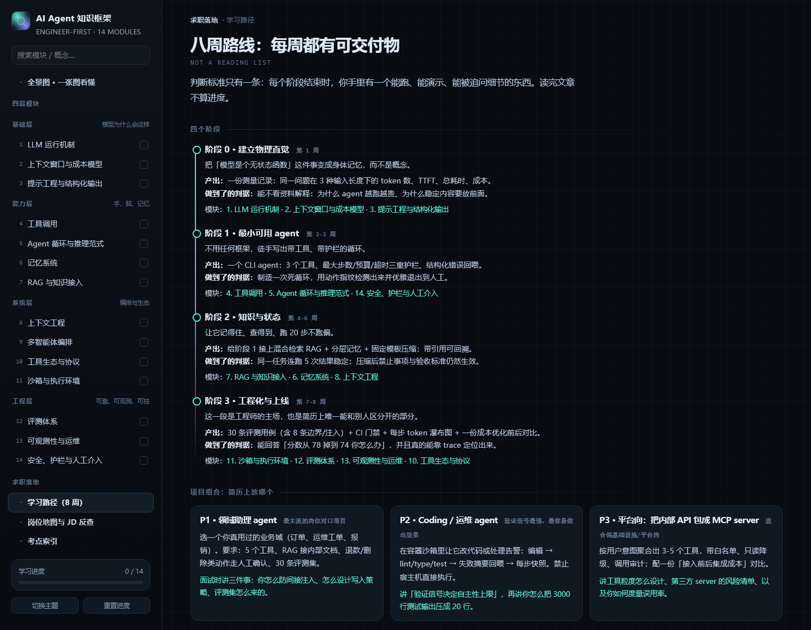
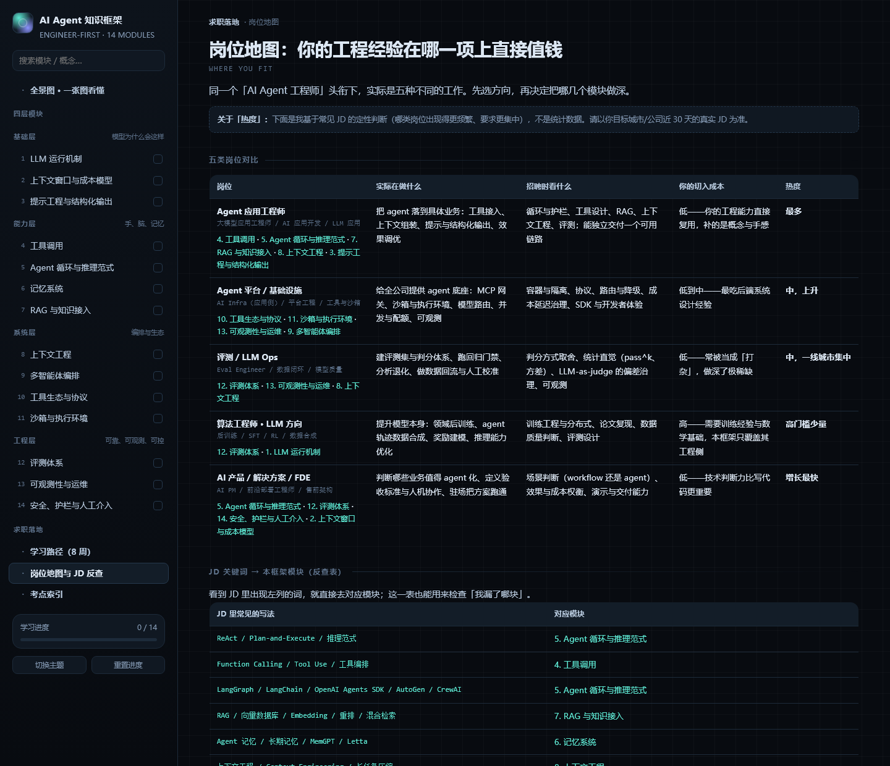

# AI Agent 技术白皮书

## ▶ 在线交互版：https://ai-agent-knowledge-framework.pages.dev/

> 面向后端 / 前端工程师的 AI Agent 知识框架：一套 14 模块的技术地图、15 张可逐帧播放的动效图解、95 条核心概念、67 个常见坑、40 道面试题与判分要点、29 条上手练习，以及一条八周可交付路线。

这份材料只有一个数据源：[`index.html`](index.html)。分章文档 [`docs/`](docs/) 与全文版 [`HANDBOOK.md`](HANDBOOK.md) 都由 `tools/build-docs.mjs` 从它生成，所以网页和文档不可能对不上。

**它回答的问题不是「AI Agent 是什么」，而是：作为一个已经会写服务、会做系统设计的人，我要补哪几块、按什么顺序补、补到什么程度能被面试追问。**

[](https://ai-agent-knowledge-framework.pages.dev/)

---

## 两种读法

| | 网页版 [在线打开](https://ai-agent-knowledge-framework.pages.dev/) | 文档版 [`docs/`](docs/) |
| --- | --- | --- |
| 形态 | 单文件、零依赖，也可 [下载 `index.html`](index.html) 双击离线用 | 18 个 Markdown 分章 + 1 个全文单文件 |
| 图解 | 15 张 SVG 动效，可单步播放数据包流转 | 同一批图的静态截屏 + 分步文字讲解 |
| 进度 | 勾选状态存本地 `localStorage` | 交给你的笔记软件 / 知识库 |
| 适合 | 第一遍建立直觉，面试前复习 | 引用、检索、打印、喂给自己的 agent |

网页版无需构建、无需依赖，在线版即 [https://ai-agent-knowledge-framework.pages.dev/](https://ai-agent-knowledge-framework.pages.dev/)；想离线看，下载 [`index.html`](index.html) 双击即可。每一章的动效图解都能用深链直接打开，例如 [工具调用](https://ai-agent-knowledge-framework.pages.dev/#/m/tool-calling)。

---

## 目录

### 第 0 章 · 全景

[00 · Agent 不是「更长的 prompt」，是一个带反馈的循环系统](docs/00-overview.md)

### 基础层 · 模型为什么会这样

| 章 | 模块 | 定位 | 门槛 |
| :-: | --- | --- | --- |
| [01](docs/01-llm-runtime.md) | LLM 运行机制 | 岗位核心能力 | 低 |
| [02](docs/02-context-window.md) | 上下文窗口与成本模型 | 岗位核心能力 | 低 |
| [03](docs/03-prompting.md) | 提示工程与结构化输出 | 高频考点 | 低 |

### 能力层 · 手、脑、记忆

| 章 | 模块 | 定位 | 门槛 |
| :-: | --- | --- | --- |
| [04](docs/04-tool-calling.md) | 工具调用 | 岗位核心能力 | 低 |
| [05](docs/05-agent-loop.md) | Agent 循环与推理范式 | 岗位核心能力 | 中 |
| [06](docs/06-memory.md) | 记忆系统 | 高频考点 | 中 |
| [07](docs/07-rag.md) | RAG 与知识接入 | 高频考点 | 中 |

### 系统层 · 编排与生态

| 章 | 模块 | 定位 | 门槛 |
| :-: | --- | --- | --- |
| [08](docs/08-context-eng.md) | 上下文工程 | 岗位核心能力 | 中 |
| [09](docs/09-multi-agent.md) | 多智能体编排 | 加分项 | 高 |
| [10](docs/10-mcp-tools.md) | 工具生态与协议（MCP） | 高频考点 | 低 |
| [11](docs/11-sandbox.md) | 沙箱与执行环境 | 高频考点 | 高 |

### 工程层 · 可靠、可观测、可控

这一层是转行者最容易建立差异化的地方——算法背景的候选人普遍不写这些。

| 章 | 模块 | 定位 | 门槛 |
| :-: | --- | --- | --- |
| [12](docs/12-evals.md) | 评测体系 | 岗位核心能力 | 中 |
| [13](docs/13-observability.md) | 可观测性与运维 | 高频考点 | 低 |
| [14](docs/14-safety.md) | 安全、护栏与人工介入 | 高频考点 | 中 |

### 附录

| 附录 | 内容 |
| --- | --- |
| [A · 八周学习路径](docs/appendix-a-learning-path.md) | 4 个阶段的目标 / 产出 / 自判据、3 个简历项目、每周节奏、出关判据 |
| [B · 岗位地图](docs/appendix-b-job-map.md) | 5 类岗位对比、15 条 JD 关键词反查、9 条经验迁移、三轮面试考什么 |
| [C · 考点索引](docs/appendix-c-interview-index.md) | 高频十题、3 道系统设计题、40 道分模块考点与答案、3 个该反问的问题 |

---

## 每一章的固定结构

```
工程类比 → 动效图解（图 + 分步讲解） → 核心概念 → 最小可用代码
        → 常见坑 → 面试怎么问（Q + 判分要点） → 上手练习
```

「最小可用代码」不是 demo 片段，而是这一模块在生产里最容易出事的那一段：并发执行工具调用、检索结果去重加引用、评测断言与 CI 退出码、按风险分档的动作审批。



---

## 内容规模

| 指标 | 数量 |
| --- | :-: |
| 技术模块 | 14（分 4 层） |
| 动效图解 | 15 |
| 核心概念 | 95 |
| 常见坑 | 67 |
| 面试题（含答案要点） | 40 |
| 上手练习 | 29 |
| 代码示例 | 14 |

---

## 重新生成文档

改内容只改 `index.html` 里的数据常量（`MODULES` / `PATH_STAGES` / `JOB_TYPES` / `COPY` 等，都在文件顶部），然后：

```bash
node tools/build-docs.mjs            # 重新生成 docs/*.md 与 HANDBOOK.md
node tools/build-docs.mjs --figures  # 另外重截 docs/figures/*.png（需要本机 Chrome）
```

脚本会把页面的 `<script>` 在 Node 里对一个 DOM 桩执行，直接读出数据常量，因此不存在第二份需要手工同步的文本。

---

## 界面预览

| 学习路径 | 岗位地图 |
| --- | --- |
| [](https://ai-agent-knowledge-framework.pages.dev/#/path) | [](https://ai-agent-knowledge-framework.pages.dev/#/jobs) |

---

## 关于岗位数据的说明

「热度」「高频考点」是我基于常见 JD 的**定性判断**，用于安排阅读优先级，不是统计数据，也不来自任何单一招聘平台。请以你目标城市 / 公司近 30 天的真实 JD 为准——[附录 B](docs/appendix-b-job-map.md) 的反查表就是为这个核对动作准备的。

## License

[MIT](LICENSE)：可自由使用、修改、再分发（含商用），保留版权声明即可。文档内容与代码同许可。
