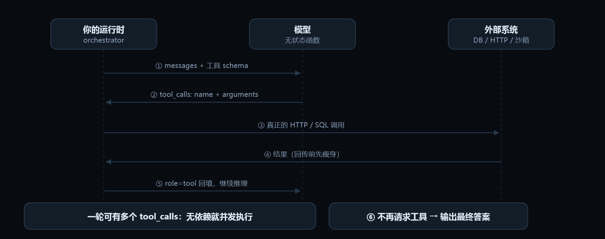

# 04 · 工具调用

> Function calling / tool use　|　能力层 · 手、脑、记忆　|　岗位核心能力 · 上手门槛低 · 权重 ●●●●●

## 工程类比

工具调用是模型发起的 RPC：你注册接口（JSON Schema），它返回一个调用请求，执行永远发生在你这边。

> 模型不会真的执行任何东西，它只是生成了一段结构化的「我想调这个函数、参数是这些」。所以工具的安全边界、鉴权、幂等，全是你的系统责任。

## 动效图解



**工具调用的真实往返：模型只出「意图」，执行在你这边**

1. 你把消息历史和工具 schema 一起传过去。schema 的 description 是写给模型看的文档。
2. 模型返回的是结构化意图：调哪个、参数是什么。它没有执行任何东西。
3. 执行发生在你的代码里——鉴权、限额、幂等键、超时都在这里。
4. 结果先瘦身再回传：只给必要字段或落盘留引用，否则上下文会被一次调用吃光。
5. 以 role=tool 回填，进入下一轮推理。失败时回喂结构化错误 + 可行动提示，它常能自纠。
6. 模型不再请求工具即视为完成。把它放进 while 循环，你手里就是一个最小 agent。
7. 一轮返回多个 tool_calls 时，无依赖的调用要并发执行：N 次串行延迟压成 1 次。

> 动效结论：理解这一张图，就理解了 agent 的「手」：意图与执行彻底分离。

网页版里这段可以逐帧播放：[「工具调用」动效图解](https://ai-agent-knowledge-framework.pages.dev/#/m/tool-calling)。

## 核心概念

### 注册即文档　`tool schema`

工具 = name + description + input schema。**description 是写给模型看的 API 文档**，必须说清「什么时候用」和「什么时候别用」，以及参数格式约束。

### 调用回路

请求 → 模型返回 tool_calls(name, arguments) → 你执行 → 以 role=tool 消息回填结果 → 模型继续。**循环直到模型不再请求工具**。

### 并行调用

一轮可返回多个 tool_calls。互相独立的调用要**并发执行**，把 N 次串行延迟压成 1 次；有依赖的才串行。

### 强制与禁用

tool_choice 可设 auto / required / none / 指定某个工具。**required 常被用来当结构化输出的载体**（强制产出 schema）。

### 错误要回喂

工具失败时，把结构化错误（错误码 + 可行动建议）作为结果返回给模型，它往往能自己纠正。抛异常打断整个循环是最差的处理方式。

### 工具数量控制

工具一多，选错率和 token 成本都上升（经验上超过 15～20 个明显退化）。手段：按场景动态挂载、分组、分层路由、命名空间前缀。

### 幂等与副作用

模型可能重复调用同一工具（重试、上下文丢失）。写操作要带**幂等键**，或强制走审批通道。

## 最小可用代码

> 生产级工具回路的三个要点：并发执行、错误回喂、结果瘦身。

```python
from concurrent.futures import ThreadPoolExecutor

def run_tools(calls):
    def one(c):
        try:
            out = REGISTRY[c.name](**json.loads(c.arguments))
            return slim(out)                       # 只回必要字段，别把 20k JSON 塞回上下文
        except Exception as e:
            return json.dumps({"ok": False, "error": type(e).__name__,
                             "detail": str(e), "hint": "检查参数或改用 list_orders"})

    with ThreadPoolExecutor(max_workers=8) as ex:   # 独立调用并发
        outs = list(ex.map(one, calls))
    return [{"role": "tool", "tool_call_id": c.id, "content": o}
            for c, o in zip(calls, outs)]
```

文件名：`tool_loop.py`

## 常见坑

- description 写成「查询订单」，模型不知道边界，于是要么不用要么乱用。
- 把整个数据库表结构当参数暴露给模型，字段名相似导致混淆。
- 工具返回值原样回填（日志、HTML 全文），上下文瞬间被吃光。
- 写操作不做幂等，模型重试导致重复下单/重复发信。
- 只给成功路径，没告诉模型「查不到时该怎么办」，它就开始编造。

## 面试怎么问

**Q4.1　模型是怎么「调用」工具的？**

A：它没有调用能力，只是基于工具 schema 生成符合格式的输出；执行由运行时完成，结果作为新消息回填，再进入下一次推理。考察点是有没有理解「模型无副作用」。

**Q4.2　工具选错或参数编造，怎么定位与治理？**

A：看 trace 里该步的候选工具与输入；治理：收紧 schema（枚举、required、反例描述）、减少同轮可见工具数、加参数校验层并把校验错误回喂、给该工具补 few-shot 并固化进评测集。

**Q4.3　多个工具调用怎么降低延迟？**

A：识别无依赖调用并发执行；配合流式解析边生成边发起；对高频只读结果做缓存；必要时用小模型做工具路由。

## 上手练习

- [ ] 给一个已有工具重写 description，加上「不适用于…」和参数枚举，观察误用率变化。
- [ ] 故意让工具抛错，比较「返回异常」与「返回结构化错误+提示」两种做法下 agent 的恢复率。

---

← 上一节：[3. 提示工程与结构化输出](03-prompting.md)

下一节：[5. Agent 循环与推理范式](05-agent-loop.md) →

