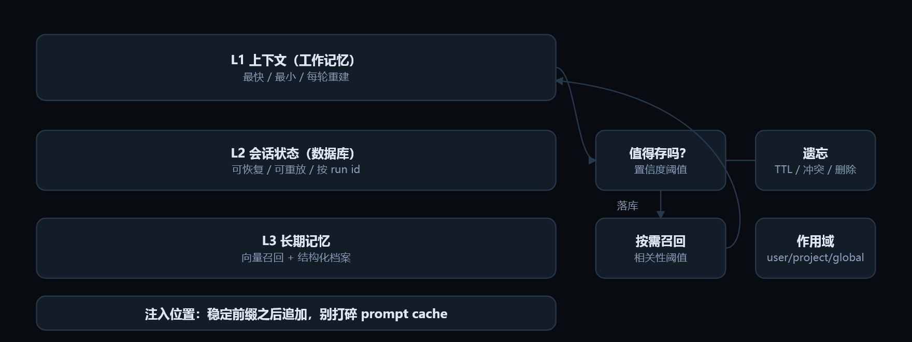

# 06 · 记忆系统

> Memory: L1 context, L2 session, L3 store　|　能力层 · 手、脑、记忆　|　高频考点 · 门槛中等 · 权重 ●●●●○

## 工程类比

记忆是分层存储：上下文是 L1 缓存，会话状态是数据库，长期记忆是向量库/图库，写入策略决定命中率。

> 模型本身没有记忆（无状态）。所谓记忆系统，就是决定「什么值得持久化、什么时候取回来、取回来放哪」的缓存层——和你做过的任何 cache 一样，难的是失效而不是存取。

## 动效图解



**记忆 = 分层存储：写入策略比存取更难**

1. L1 就是上下文窗口本身，容量最小、每轮重建。模型没有内置记忆，一切靠你注入。
2. L2 是会话状态：消息历史、工具结果、检查点。它让任务可中断、可重放。
3. 写入要判定：只存稳定事实、偏好与约束。闲聊和中间结论一律不进库——宁少勿错。
4. L3 分两半：语义/情景记忆走向量召回，画像与权限这类结构化事实走精确查询。
5. 读取按需召回，低于相关性阈值就不注入；注入位置在稳定前缀之后，否则缓存全废。
6. 必须支持遗忘与隔离：TTL、冲突覆盖、用户删除请求，以及 user/project 作用域。跨用户串味是数据泄露。

> 动效结论：和你做过的任何缓存一样：难点不是存取，是写入策略与失效。

网页版里这段可以逐帧播放：[「记忆系统」动效图解](../index.html#/m/memory)。

## 核心概念

### 三类记忆

**短期**：当前上下文里的工作信息。**情景**（episodic）：发生过什么——对话、任务轨迹、成败。**语义**（semantic）：稳定事实与偏好——用户角色、项目约定、术语表。

### 写入时机

不是每句话都存。触发候选：用户显式要求记住、任务收尾摘要、抽取到可复用偏好或约束。**写入要过一遍「值不值得」判定**，宁可少存。

### 读取与注入位置

每轮全量注入 vs 按需检索。检索结果应在稳定前缀之后追加，避免打碎 prompt cache；相关性低于阈值就不注入。

### 结构化优先

用户画像、权限、项目常量用**表结构 + 精确查询**，别塞进向量库做模糊匹配。向量检索只适合「说不清关键词」的语义召回。

### 更新与冲突

新旧事实冲突时：覆盖会丢历史，双时间线（都保留 + 生效区间）更稳但更复杂。**错误记忆比没有记忆更糟**，因为它会被当事实反复引用。

### 遗忘机制

TTL、访问频次衰减、容量上限淘汰、用户删除请求（合规必须支持）。

### 分层管理思想

MemGPT 一类做法让模型自己分页（上下文当主存、外部当磁盘）。今天更常见的是 compaction + 检索 + 结构化档案三者组合。

## 最小可用代码

> 写入侧的三道过滤：值得存、能定位、会过期。

```python
def maybe_remember(turn, store):
    cand = extract_facts(turn)     # 只抽稳定事实/偏好/约束，不抽闲聊
    keep = [f for f in cand
            if f.confidence > 0.7  # 不确定就先别存
            and not contradicts(store, f)]
    for f in keep:
        upsert(store, key=f.key,               # 同 key 覆盖，保留 revision 历史
               value=f.text, scope=f.scope,     # user / project / global
               source=turn.id, expires=f.ttl)

def recall(query, store, k=5, min_score=0.55):
    hits = hybrid_search(query, store, k=k * 4)   # 向量 + 关键词
    hits = [h for h in rerank(query, hits) if h.score >= min_score]
    return hits[:k]
```

文件名：`memory.py`

## 常见坑

- 把整段对话无限 embedding 进库，检索时全是重复噪声。
- 记忆注入位置在 system 之前且每轮不同，prompt cache 全废。
- 没有作用域隔离，A 用户的偏好用在了 B 用户身上（数据泄露）。
- 让模型「自己决定记什么」但不给判定标准，存了一堆无用中间结论。
- 无法删除：用户要求遗忘时找不到源头。

## 面试怎么问

**Q6.1　长期记忆的写入策略怎么设计？**

A：触发（显式指令/任务收尾/偏好抽取）→ 置信度阈值 → 与既有记忆去重与冲突检测 → 带作用域和 TTL 落库 → 记录来源便于回溯删除。核心是「宁少勿错」。

**Q6.2　记忆和 RAG 有什么区别？**

A：RAG 检索外部知识库（共享、相对静态、按文档权限）；记忆检索的是与该用户/会话共同演进的私有事实（量小、高频写、要强隔离与可撤销）。

**Q6.3　上下文放不下历史怎么办？**

A：分层：最近若干轮原文 + 早期轮次结构化摘要 + 关键事实常驻档案 + 需要时检索回原文。本质就是缓存换页策略。

## 上手练习

- [ ] 给自己的 agent 加一个「任务收尾摘要」写入器，用固定模板（目标/结论/未决/偏好）。
- [ ] 设计记忆作用域方案（user/project/global），并验证跨用户读取不可能发生。

---

← 上一节：[5. Agent 循环与推理范式](05-agent-loop.md)

下一节：[7. RAG 与知识接入](07-rag.md) →

