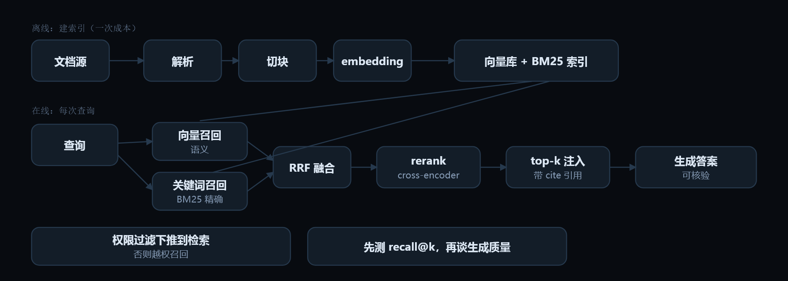

# 07 · RAG 与知识接入

> Retrieval-augmented generation　|　能力层 · 手、脑、记忆　|　高频考点 · 门槛中等 · 权重 ●●●●○

## 工程类比

RAG 是你自己搭的搜索子系统：离线索引（分块+向量）+ 在线召回（向量+关键词）+ 重排 + 把 top-k 塞进上下文。

> 别把它当魔法。绝大多数「模型答错了」其实是「没检索到」或「检索到但排序太靠后」——所以先测召回，再谈生成质量。

## 动效图解



**RAG 是搜索子系统：召回 → 融合 → 精排 → 注入**

1. 切块按语义与结构（标题、函数、段落），保留父子块与 metadata。切块策略的影响远大于换 embedding 模型。
2. embedding 把文本变成向量存库；同一份内容还要建关键词索引，因为向量对「错误码 E1042」这类精确匹配很弱。
3. 在线两路并召：向量管语义近似，BM25 管精确命中。只用向量的 RAG 一定在专有名词上翻车。
4. RRF 倒数排名融合，避免两套分数尺度不一致的调参地狱。
5. rerank 用 cross-encoder 逐对打分：召回 50 条 → 精排 5 条。这一步通常是性价比最高的精度提升。
6. top-k 带可回溯引用注入上下文。k 不是越大越好，噪声会稀释注意力。
7. 两条红线：权限过滤必须下推（越权召回是最高频事故），以及先量检索指标再调 prompt。

> 动效结论：绝大多数「模型答错了」其实是没检索到或排序太靠后。先定位在哪一层丢分。

网页版里这段可以逐帧播放：[「RAG 与知识接入」动效图解](../index.html#/m/rag)。

## 核心概念

### 离线索引

解析 → 按语义/结构切块（标题、函数、段落，保留父子关系与 metadata）→ embedding → 入向量库。**切块策略的影响远大于换 embedding 模型**。

### 混合检索　`hybrid + RRF`

向量召回擅长语义，拙于精确术语、代码、编号、专有名词。**必须叠加 BM25/关键词**，再用 RRF 融合排序。

### 重排 rerank

召回 50～100 条，用 cross-encoder 精排出 5 条。这一步通常是**性价比最高的精度提升**。

### 查询改写

用户问题常不适合直接检索：拆子查询、多路改写、HyDE（先生成假设答案再拿它检索）。

### Agentic RAG

把检索变成工具，让模型自己决定「查几次、换什么词、要不要先看目录」。更能处理多跳问题，代价是延迟与成本。

### 权限与元数据过滤

检索必须带 ACL 下推。**越权召回文档是 RAG 最高频的安全事故**，而且模型不会提醒你。

### 结构化数据走别的路

聚合、计数、多跳关系应该用 SQL / 图查询（Text-to-SQL、GraphRAG），向量相似度做不了「上季度华东区环比」。

### 两层评测

检索层：recall@k、MRR。生成层：faithfulness（是否只依据给定材料）、引用正确率。**先看检索指标再调 prompt。**

## 最小可用代码

> 混合召回 + RRF 融合 + 权限过滤，是可直接上线的最小管线。

```python
def retrieve(q, user, k=5):
    f = {"acl": user.groups, "kind": "doc"}   # 过滤下推，不是取回后再筛
    v = vec_search(embed(q), filter=f, top=50)
    b = bm25_search(q, filter=f, top=50)
    fused = rrf([v, b], weight=[0.6, 0.4])    # 倒数排名融合，免去分数尺度
    cand = [d for _, d in fused[:40]]
    top = cross_encode_rerank(q, cand)[:k]
    return [{
        "id": d.id, "text": d.text,
        "cite": f"{d.source}#L{d.line}"       # 必须可回溯，供引用与调试
    } for d in top]
```

文件名：`retrieve.py`

## 常见坑

- chunk 固定 512 且不看结构，把一张表切成两半。
- 只用向量检索，用户搜「错误码 E1042」召回为空。
- top-k 给到 20，上下文塞满噪声，模型开始混淆来源。
- 没做引用溯源，答对了也无法验证，出错时定位不到是哪份文档。
- 评测只看「回答像不像样」，不看检索是否命中，优化方向全错。

## 面试怎么问

**Q7.1　RAG 答非所问，你的排查顺序是什么？**

A：① 检索是否命中正确文档（recall@k、看 top-k 内容）② 命中但排序靠后 → rerank ③ 命中且排序正常但答错 → 生成侧（约束、引用要求、模型能力）④ 分块割裂语义 → 索引侧。关键是先定位在哪一层丢分。

**Q7.2　什么时候不用 RAG 而用长上下文？**

A：文档总量小且稳定、需要全局推理、跨文档关联密集时可直接放长窗口；量大、需权限隔离、需更新与溯源时 RAG 更便宜可控。也可组合：粗筛后放长窗口。

**Q7.3　如何防止模型编造检索里没有的内容？**

A：强制引用（每条结论带 cite id）、无依据时的固定拒答模板、输出后做 faithfulness 校验（抽断言逐条回查材料）、把拒答样本放进 few-shot。

## 上手练习

- [ ] 拿 20 份真实文档搭一个最小 RAG，先只测 recall@10，记录哪些查询失败。
- [ ] 对同一批查询对比：纯向量 / 纯 BM25 / 混合+rerank 的 recall 与最终答案质量。

---

← 上一节：[6. 记忆系统](06-memory.md)

下一节：[8. 上下文工程](08-context-eng.md) →

