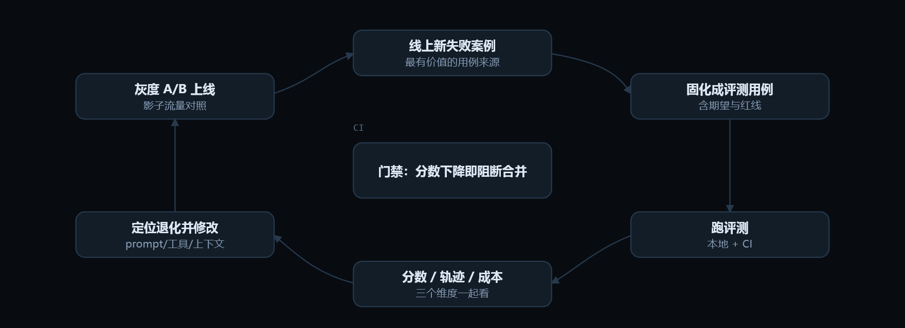

# 12 · 评测体系

> Evals: your regression suite　|　工程层 · 可靠、可观测、可控　|　岗位核心能力 · 门槛中等 · 权重 ●●●●●

## 工程类比

评测集就是 agent 的单元测试 + CI 门禁。没有它，你改 prompt 是在凭感觉调参。

> 这是工程师转 AI 岗最容易建立差异化的模块：很多人轻视评测与数据闭环，而这恰恰是团队最缺的能力。

## 动效图解



**评测飞轮：失败 → 用例 → 门禁 → 灰度 → 新失败**

1. 起点是线上真实失败，不是想象出来的用例。happy path 用例再多也挡不住第一周翻车。
2. 每条失败固化成一条用例：输入 + 可判定的期望 + 禁止调用的工具 + 步数/成本上限。
3. 同配置跑 3～5 次。单次结果说明不了什么——pass^k 比 pass@k 更能预测能不能上线。
4. 三个维度一起看：结果分、轨迹（是否走了该走的步骤、有没有危险动作）、成本延迟。
5. 修改后必须过门禁：分数下降就阻断合并。这一步把「凭感觉调 prompt」变成工程。
6. 灰度与影子流量做真实对照，避免离线分数涨了、线上体验反而变差。
7. 线上继续产生新失败 → 回到第一步。这个飞轮本身，就是岗位的核心交付物。

> 动效结论：能讲清「我怎么给 agent 搭评测」的候选人，比能背五种推理范式的候选人稀缺得多。

网页版里这段可以逐帧播放：[「评测体系」动效图解](https://ai-agent-knowledge-framework.pages.dev/#/m/evals)。

## 核心概念

### 三层指标

**结果层**：任务成功率；**轨迹层**：是否调了对的工具、步数、有没有危险动作；**经济层**：成本与 P95 延迟。只看结果会放过「侥幸成功」。

### 评测集从哪来

线上真实失败案例（最有价值）+ 人工构造的边界用例 + 合成扩充。起步 20～50 条就能显著改善决策质量，别等「凑够 1000 条」。

### 判分方式梯度

规则断言/精确匹配（便宜可靠，优先）→ **LLM-as-judge**（可扩展，但有位置偏好、长度偏好、自我偏好）→ 人工抽样校准 judge。

### 过程与结果分离

「删库后重建」也算完成任务——结果满分但轨迹危险。要单独打安全/合规标签，不能被平均分掩盖。

### 稳定性指标

pass@k（k 次至少一次成功，看能力上限）与 pass^k（k 次全成功，看可上线性）。**同配置跑 3～5 次看方差**，单次结果说明不了什么。

### 公开基准

SWE-bench（真实代码修复）、GAIA（通用助理任务）、τ-bench（工具调用 + 模拟用户）、BFCL（函数调用）、WebArena（浏览器）。**榜单只能粗筛，必须用自有任务集复测。**

### 上线闭环

CI 里跑评测集做门禁（分数下降即阻断合并）→ 灰度 A/B → 影子流量 → 线上新失败案例回流成评测用例。这个飞轮是岗位核心交付物。

## 最小可用代码

> 最小可用评测台：数据集 + 断言 + judge + 多次跑看方差。

```python
CASES = load_jsonl("evals/orders.jsonl")   # {input, expect, forbidden_tools, max_steps}

@pytest.mark.parametrize("case", CASES)
def test_case(case, n=3):
    runs = [agent.run(case["input"]) for _ in range(n)]
    ok = [r for r in runs if satisfies(r, case["expect"])]
    assert len(ok) == n, f"pass^{n} 失败: {len(ok)}/{n}"    # 稳定性优先于上限
    for r in runs:
        assert not (set(r.tools) & case["forbidden_tools"])  # 轨迹红线
        assert r.steps <= case["max_steps"] and r.cost <= case["max_cost"]
        assert judge(r, case["input"]) >= 4                   # 1-5 分，需人工校准过

def satisfies(r, expect):
    return all(re.search(p, r.answer) for p in expect)        # 能写规则就别用 judge
```

文件名：`eval_harness.py`

## 常见坑

- 只测 happy path，线上第一周全是边界用例翻车。
- 用 LLM-as-judge 但没和人工标注对齐过，等于引入一个未验证的依赖。
- 改 prompt 后只跑一次就下结论「变好了」。
- 评测集泄漏进 few-shot 或训练数据，分数虚高。
- 把公开榜单当选型依据，上线后发现完全不适配自己的任务分布。

## 面试怎么问

**Q12.1　怎么给一个 agent 项目从零搭评测？**

A：① 收集 20～50 条真实任务与失败案例 ② 定义可判定的期望（规则/断言优先）③ 记录轨迹与成本 ④ 主观判断处引入 judge 并用人工样本校准一致性 ⑤ 接进 CI 做门禁 ⑥ 线上新失败持续回流。

**Q12.2　LLM-as-judge 的坑？**

A：位置偏好（先出现的更容易被选）、长度偏好（更长显得更好）、自我偏好（偏爱与自己同源模型的输出）、评分漂移（换 judge 版本分数不可比）。对策：成对比较随机化顺序、用规则锚点、定期人工一致性抽检、锁定 judge 版本。

**Q12.3　分数从 78 掉到 74，你怎么办？**

A：先确认评测集与 judge 版本未变；按标签维度拆分定位是哪类用例退化；看轨迹差异（步数、工具选择）判断是模型行为变了还是上下文组装变了；跑多次排除噪声；确认后退出版本。

## 上手练习

- [ ] 为你的 demo 写 20 条评测用例，其中至少 5 条是边界/拒答类。
- [ ] 实现 pass^3：同配置跑 3 次，统计不稳定用例并分析原因。

---

← 上一节：[11. 沙箱与执行环境](11-sandbox.md)

下一节：[13. 可观测性与运维](13-observability.md) →

